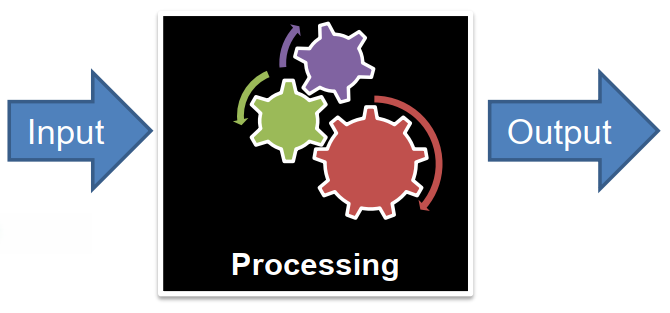
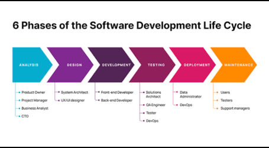
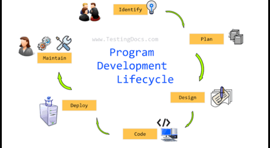
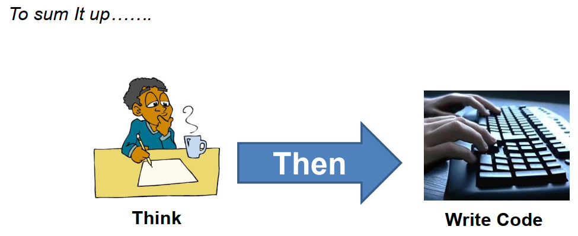
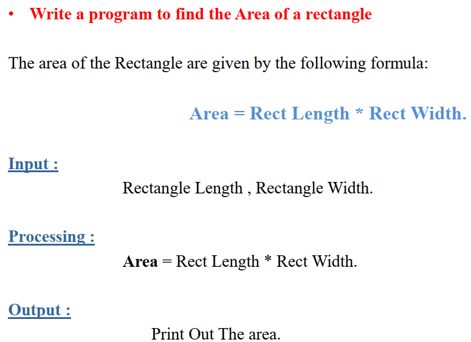

# 00)**Introduction To Programming With Java Programming Language:

-------------------------------------------------------------------------

## 00.01)**What 's The Programming?

-------------------------------------------------------------------------
- Programming , Or Program Development Life Cycle (PDLC) Is A Process Of Problem Solving...
    - 
Input: It Is Different Data (Data Items) That Gets From The User Of Your Own Java Computer Programming Codes...

    - 
Processing: It Is Different Methods (Functions , Or Operations) That Done On The Input That Get From The User Of Your Own Java Computer Programming Codes To Get The Specified Output Of Your Own Java Computer Programming Codes...

    - 
Processing: It Is Different Methods (Functions , Or Operations) That Done On The Input That Get From The User Of Your Own Java Computer Programming Codes To Get The Specified Output Of Your Own Java Computer Programming Codes...

<table align="center">
    <tr>
        <td></td>
    </tr>
</table>
-------------------------------------------------------------------------
  - There Are Different Steps Of The Programming , Or Programming Development Life Cycle (PDLC) Like:
    - Step1: Analyze The Problem Of Your Own Java Computer Programming Codes:
      - A)**Understand Overall The Problem Of Your Own Java Computer Programming Codes...
      - B)**Does Your Own Java Computer Programming Codes Requires User Interaction???
        - If Yes , What Is The Expected Input Of Your Own Java Computer Programming Codes??
        - What Is The Expected Output Of Your Own Java Computer Programming Codes???
      - C)**Design Steps (Algorithm) To Solve The Problem Of Your Own Java Computer Programming Codes...
        - Algorithm Is A Step By Step Of Problem Solving Process...
    - Step2: Implement The Algorithm Of Your Own Java Computer Programming Codes:
      - A)**Implement The Algorithm Of Your Own Java Computer Program In Codes...
      - B)**Verify That The Algorithm Of Your Own Java Computer Programming Codes Work Well...
    - Step3: Maintenance Your Own Java Computer Programming Codes:
      - A)**Use , And Modify Your Own Java Computer Programming Codes If The Problem Domain Changes...
<table align="center">
    <tr>
        <td>
            </td>
        <td>
            </td>
    </tr>
</table>
----------------------------------------------------------------------------

> [!Important]
> 
If The Problem Is A Complex Java Programming Problem , Then You Should Divide This Problem Into More Than One Subproblems , And Then Analyze Each Subproblem As A Bove...

-----------------------------------------------------------------------------

> [!Tip]
> 
To Sum It 'S Up , Think About The Program , And Then Write A Professional Codes To Solve This Problem By Using Your Own Java Computer Programming Codes...

<table>
    <tr>
        <td></td>
    </tr>
</table>

----------------------------------------------------------------------------------
## 00.02)**Rectangle Area Example:
- ##### Input (Data , Or Data Items): It Refers To Rectangle Length , And Rectangle Width...
- ##### Processing (Methods , Operations , Or Functions): It Refers To The Multiplication Of The Rectangle Length By The Rectangle Width...
- ##### Output (Information , Or Result): It Prints Out The Area Of The Rectangle For The User Of Your Own Java Computer Programming Codes...

------------------------------------------------------------------------------------

