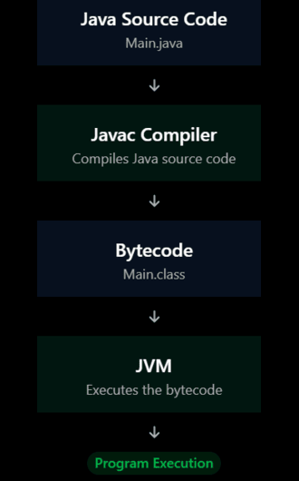
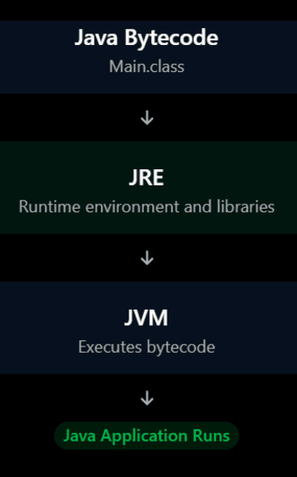
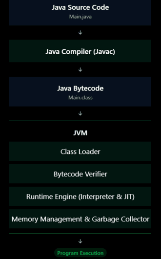
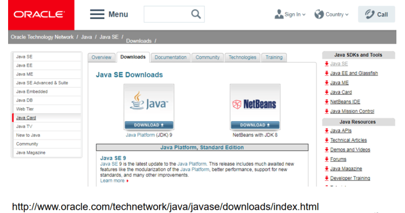
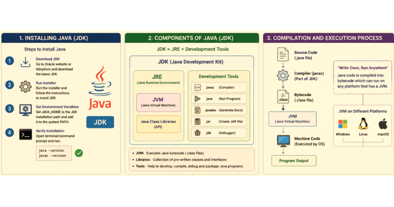

# 01)**How To Install The Java Programming Language:

### 01.01)**What Is The JDK?

  - 
JDK Refers To The Java Development Kit , It Is A Software Developments That Contains Different Software Tools Like Execute , Debug , Run , And Compile Your Own Java Computer Programming Codes...

 
------------------------------------------------------------------------------------------- 

> [!Important]
> 
In The  Simple , JVM Refers To Java Virtual Machine That It Is Mainly Used To Run Or Execute The ByteCode File Of Your Own Java Computer Programming Codes...

---------------------------------------------------------------------------------------------

##### 01.02)**There Are Different Features Of The JDK (Java Development Kit)?

  - 
JVM: It Refers To The Java Virtual Machine , It Is Mainly Used To Run Or Execute The Bytecode File Of Your Own Java Computer Programming Codes...

  - 
JRE: It Refers To The Java Runtime Environment , It Is Mainly Used To Run Or Execute Your Own Java Computer Programming Codes....

  - 
JAVAC: It Refers To The Java Compiler , It Is Mainly Used To Compile Your Own Java Computer Programming Codes...

  - 
JAVADOC: It Refers To The Java Documentation , It Is Mainly Used To Add A Documentation File For Your Own Java Computer Programming Codes File...

  - 
JAVA: It Launches , Or Executes Your Own Java Computer Programming Codes...

  - 
JAVADB: It Refers To The Java Debug , It Is Mainly Used To Debug Your Own Java Computer Programming Codes...

-----------------------------------------------------------------------------------------------

### 01.03)**What Is The JRE (Java Runtime Environment)?

  - 
JRE (Java Runtime Environment) Is Mainly Used To Run , Or Execute Your Own Java Computer Programming Codes...

------------------------------------------------------------------------------------------------

  ##### 01.03.2)**There Are Different Features Of The JRE (Java Runtime Environment)?
  
  - 
JVM: It Refers To The Java Virtual Machine , It Is Mainly Used To Execute , Or Run The Bytecode File Of Your Own Java Computer Programming Codes...

  - 
JAVA Libraries Files: It Contains Different Classes , And Methods...

  - 
Bytecode Verifier: It Is Mainly Used To Check The Bytecode File For Security , And Correctness...

  - 
Java Runtime Environment: It Is An Environment That Runs Or Executes Your Own Java Computer Programming Codes In It...

--------------------------------------------------------------------------------------------------

<table>
  <tr>
    <td></td>
    <td>
      
    </td>
    <td>
      
    </td>
  </tr>
</table>

---------------------------------------------------------------------------------------------------

### 01.04)**What Is The Netbeans?

  - 
It Is One Of Many IDEs (Text Editors) That Mainly Used To Write Your Own Java Computer Programming Codes , And Then Executing , Or Running Your Own Java Computer Programming Codes...

---------------------------------------------------------------------------------------------------
<table align="center" width="75%">
  <tr>
    <td></td>
  </tr>
  <tr>
    <td></td>
  </tr>
</table>
