# 02)**Your Frist Java Computer Program:

### 02.1)**What Is Class In The Java Programming Language?

  - 
02.1.1)**Class In The Java Programming Language Is A Group Of Data Items (Inputs) , And Methods (Functions , Operations , Or Processor) About Your Own Java Computer Programming Codes...

  
    - 
02.1.1.1)**Data Item: It Also Called Input , Or Data , It Refers To Different Data Items That Got From The User Of Your Own Java Computer Programming Codes...

    
    - 
02.1.1.2)**Methods: It Also Called Operations , Processors , Or Functions , It Refers To Different Operations That Done On The Data Item (Input) Of Your Own Java Computer Programming Codes To Display The Output Of Your Own Java Computer Programming Codes...

    
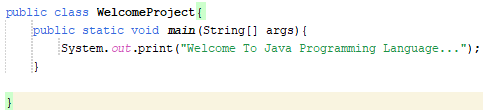

----------------------------------------------------------------------------------------------------------

### 02.2)**What Is Main Method In The Java Programming Language?

  - 
02.2.1)**Any Java Computer Programming Codes Contain Only One Main Method (Main Function)...

  
  - 
02.2.2)**It Is The Main Function That Any Text Editors (IDEs) Like NetaBeans Start Executing Or Running Your Own Java Computer Programming Codes From This Method...

  
    - 
02.2.2.1)**Main Method Is The Entry Point , Or Starting Point That Any Text Editors (IDEs) Like NetBeans Starting The Executing , Or Running Process From This Point...

  
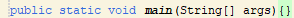

  
------------------------------------------------------------------------------------------------------------

### 02.3)**How To Display A Message (Text) For The User Of Your Own Java Computer Programming Codes?

  - 
02.3.1)**If You Want To Print A Message For The User Of Your Own Java Computer Programming Codes , Then You Must Use: <strong>System.out.print("Welcome To Java");</strong>

  
  - 
02.3.2)<strong>**There Are Different Features Of The Print Statement Like:</strong>

  
    - 
02.3.2.1)**System: It Is A Java Programming Packages That Contains A Collection Of Java Methods , And Java Classes...

    
    - 
02.3.2.2)**out: It Is A Java Programming Class From The System Package From The Programming Language That Mainly Used To Get Print Method To Print A Message For The User Of Your Own Java Computer Programming Code...

    
    - 
02.3.2.3)**print: It Is Mainly Used To Print A Message Text For The User Of Your Own Java Computer Programming Codes...

    
  
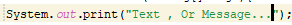

  
----------------------------------------------------------------------------------------------------------------

#### Very Important Notes:

> [!important]
> 
Java Programming Language Is A Case Sensitive Language , This Means That The Java Programming Is Affected By Small Letters , Or Capital Letters Like The System Package From The Java Programming Language , The Frist Letter Must Be A Capital Letter , The out Class From The System Package From The Java Programming Language , The Frist Letter Must Be A Capital Letter , The print Method (Function) From The out Class From The System Package From The Java Programming Language , The Frist Letter Must Be A Capital Letter...

> 
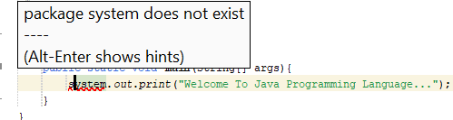

--------------------------------------------------------------------------------------------------------------------

> [!Warning]
> 
Any Line Of Codes In Any Java Computer Programming Codes Must End With Semicolon (;) , This Is Very Important , Because It Is Known Different Text Editors (IDEs) Like NetBeans , Or ETC That It Is The Ending Of This Coding Line...

> 
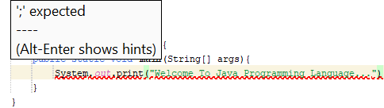

----------------------------------------------------------------------------------------------------------------------

### 02.4)**What Is The Processing Of Your Own Java Computer Programming Codes?

  - 
02.4.1)**Create Or Modify The Source Codes Of Your Own Java Computer Programming Codes...

  
  - 
02.4.2)**Store The Source Codes Of Your Own Java Computer Programming Codes On The Disk (The Memory)...

  
    - 
02.4.2.1)**Source Codes Of Your Own Java Computer Programming Codes Developed By The Developer...

    
    
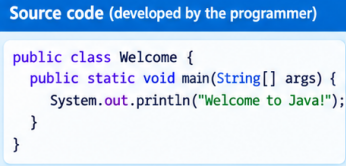

    
  - 
02.4.3)**Compile The Source Codes Of Your Own Java Computer Programming Codes...

  
  - 
02.4.4)**Store The ByteCode File Of Your Own Java Computer Programming Codes On The Disk (The Memory)...

  
  
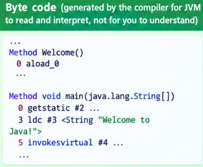

  
  - 
02.4.5)**Runs , Or Executes The Bytecode Of Your Own Java Computer Programming Codes...

  
    - 
02.4.5.1)**ByteCode File Of Your Own Java Computer Programming Codes Is Generated By The Compiler For JVM (Java Virtual Machine) To Read , Or Interpret Not For Your You To Understand...

    
  - 
02.4.6)**Displaying The Result Of Your Own Java Computer Programming Codes...

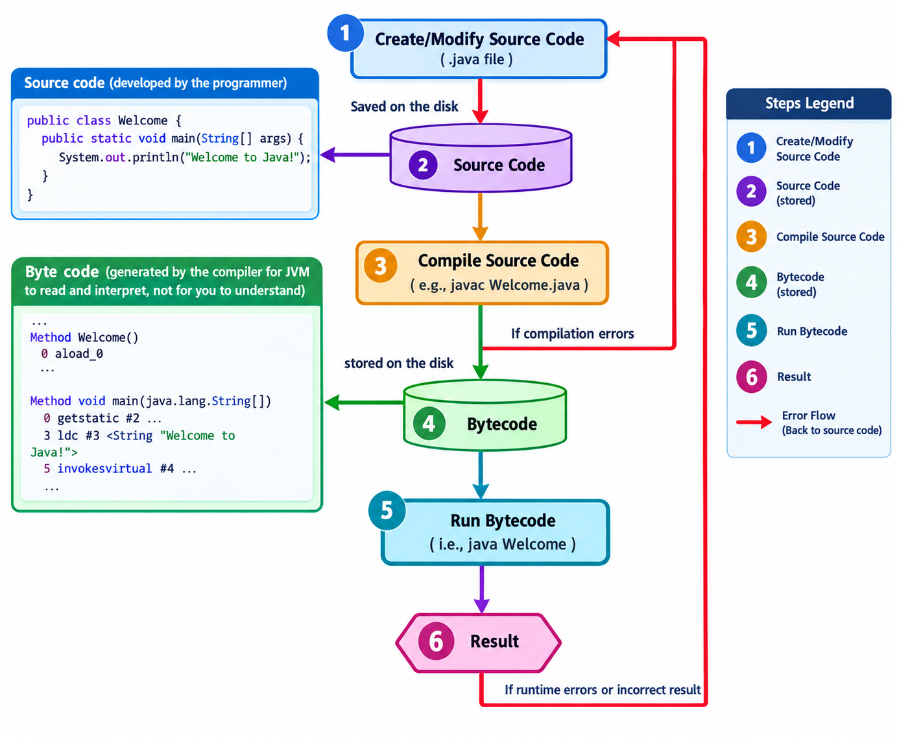

  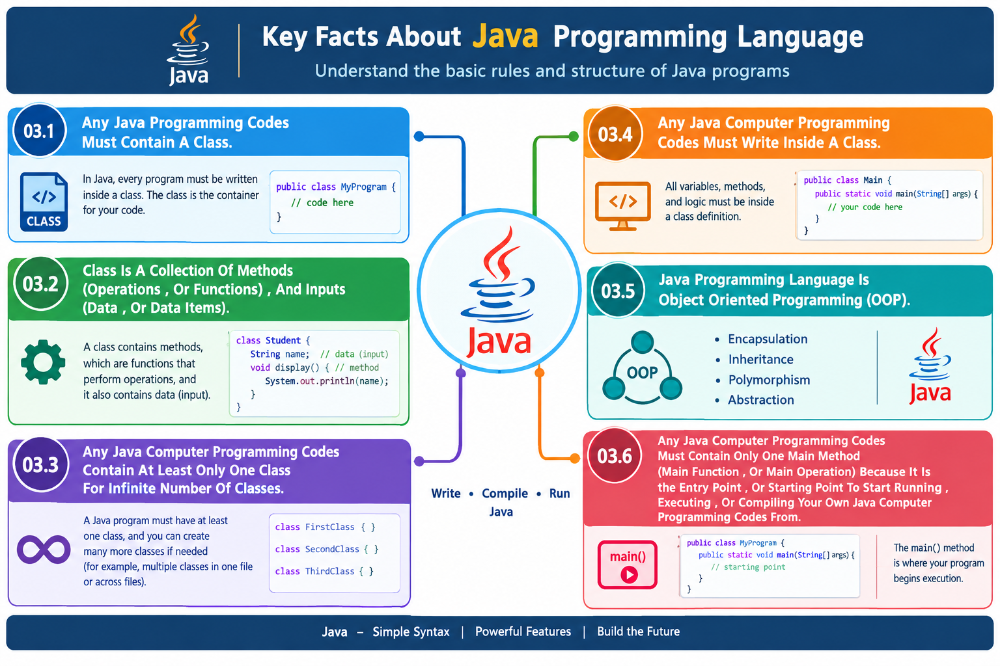

------------------------------------------------------------------------------------------------------------------------

### 02.5)**There Are Different Types Of The Programming Errors In The Java Programming Language Like:

  - 
02.5.1)**Syntax Error: It Is Detected By Any Compiler (Text Editors (IDEs)) Like NetBeans... For Example:

  
    - 
02.5.1.1)**Forgetting Semicolon (;) At The End Of Any Coding Line In Your Own Java Computer 
      Programming Codes...

   

  - 
02.5.1.2)**Using system , By Using The Frist Letter From The System Package As A Small Letter...

     
    

    
  - 
02.5.2)**Logical Error: It Produces Un Expected , Or Incorrect Result (Output) From Your Own Java Computer Programming Codes... For Example:

  
    - 
02.5.2.1)**If You Want To Divide Two Integer Numbers Like The Frist Number Is Equal To 4 , And The Second Number Is Equal To 3 , And The Result Will Store In Variable Named By Division With Integer Data Type , This Produces An Un Expected Result Like 1 , Not 1.333333....

    
    <table>
      <tr>
        <td align="center" colspan="2" >
          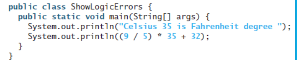
        </td>
        <td></td>
      </tr>
      <tr>
        <td>
          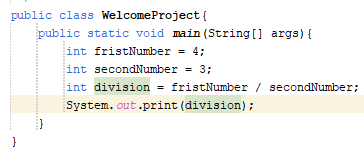
        </td>
        <td>
          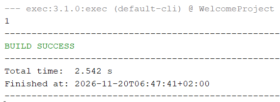
        </td>
      </tr>
    </table>
    
  - 
02.5.3)**Runtime Error: It Causes Your Own Java Computer Programming Codes To Abort... For Example:

  
    - 
02.5.3.1)**Division The Number By Zero , Because It Produces Infinite Result From Your Own Java Computer Programming Codes...

<table>
  <tr>
    <td>
      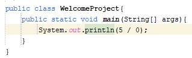
    </td>
    <td>
      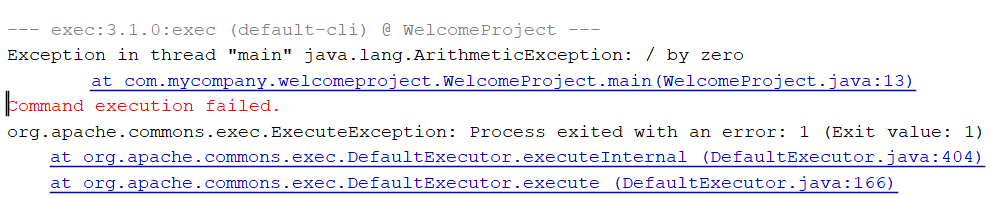
    </td>
  </tr>  
</table>

--------------------------------------------------------------------------------------------------------------------------

### 02.6)**There Are Different Types Of The Comment In The Java Programming Language Like:

  - 
02.6.1)**Single Line Comment: // (Control (CTRL) + "ظ" : It Is Mainly Used To Make A Single Line Comment In Your Own Java Computer Programming Codes...

  
  - 
02.6.2)**Multiple Line Comments: /* */ : It Is Mainly Used To make A Multiple Lines Of Comments In Your Own Java Computer Programming Codes...

  

  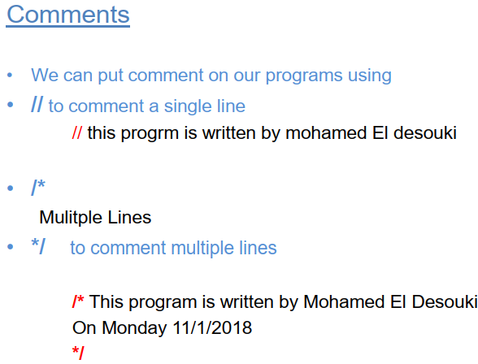

---------------------------------------------------------------------------------------------------------------------------

> [!Tip]
> 
Different Types Of Comments Like Single Comment , Or Multiple Lines Comments Does Not Appear For Different Users Of Your Own Java Computer Programming Codes While Executing , Or Running Your Own Java Computer Programming Codes...

> 
Different Types Of Comments Are Used As A Tool Tip For Different Developers To Know Why The Developer Writting This Line Of Code...

---------------------------------------------------------------------------------------------------------------------------

<table>
  <tr>
    <td align="center">
      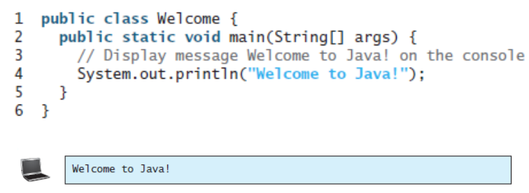
    </td>
  </tr>
  <tr>
    <td align="center">
      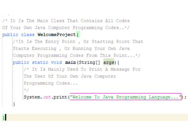
    </td>
    <td align="center">
      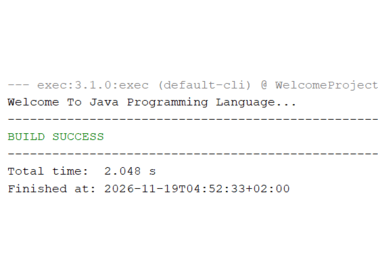
    </td>
  </tr>
</table>
