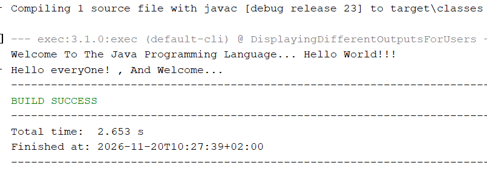

# 03)**Displaying Different Outputs For Different Users:

<strong align="justify">03.1)**There Are Different Methods For Displaying , Or Printing Outputs For Different Users Of Your Own Java Computer Programming Codes Like:</strong>
  - 
03.1.1)**System.out.print("Text , Or Message In A Same Line");: It Is Displaying A Message In The Same Line In Your Own Java Computer Programming Codes...

  - 
03.1.2)**System.out.println("Text , Or Message In A New Line");: It Is Displaying A Message In The New Line In Your Own Java Computer Programming Codes...

<table>
  <tr>
    <td>
      
    </td>
    <td>
      
    </td>
  </tr>
</table>

-----------------------------------------------------------------------------------------------------------------------------

> [!Important]
> 
**Different Text Editors (IDEs) Like NetBeans , Eclipse , And More Agnors Different Spaces In Your Own Java Computer Programming Codes...

