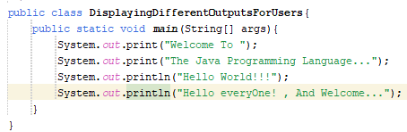
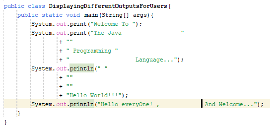
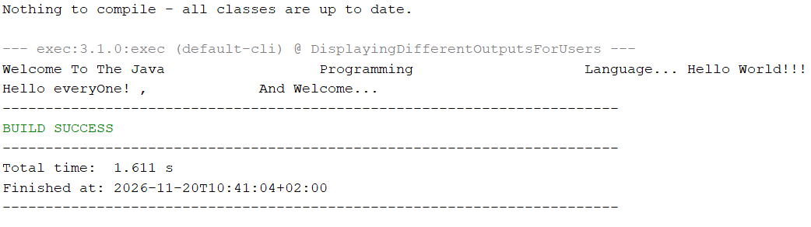
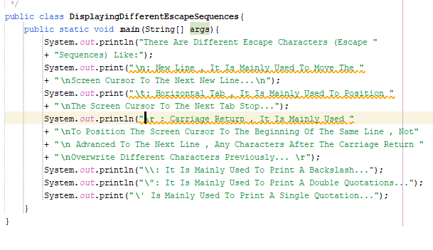
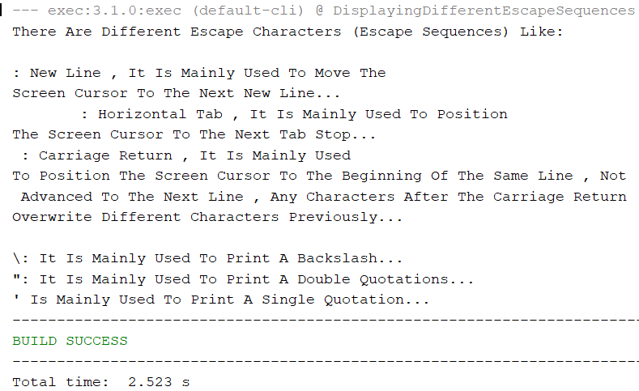
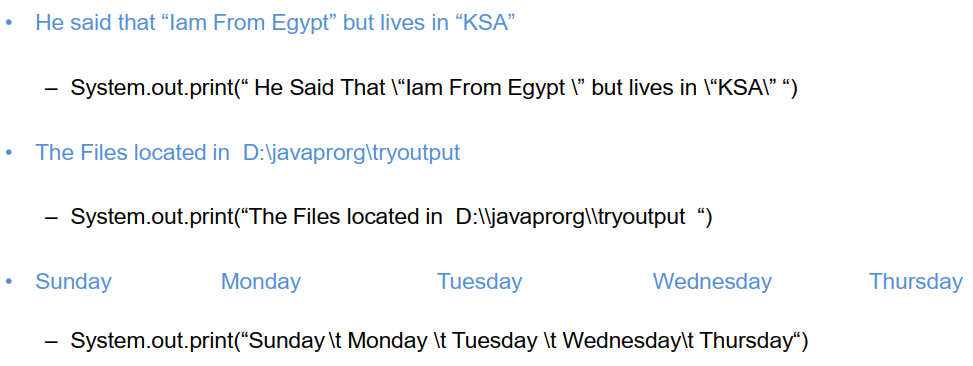
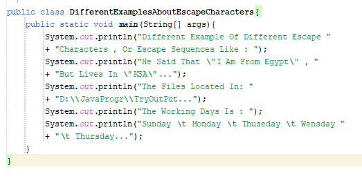
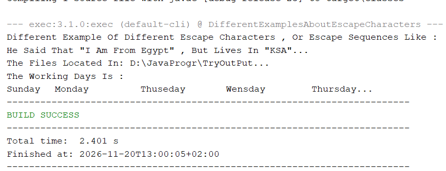

# 03)**Displaying Different Outputs For Different Users:

<strong align="justify">03.1)**There Are Different Methods For Displaying , Or Printing Outputs For Different Users Of Your Own Java Computer Programming Codes Like:</strong>
  - 
03.1.1)**System.out.print("Text , Or Message In A Same Line");: It Is Displaying A Message In The Same Line In Your Own Java Computer Programming Codes...

  - 
03.1.2)**System.out.println("Text , Or Message In A New Line");: It Is Displaying A Message In The New Line In Your Own Java Computer Programming Codes...

<table>
  <tr>
    <td>
      
    </td>
    <td>
      
    </td>
  </tr>
</table>

-----------------------------------------------------------------------------------------------------------------------------

> [!Important]
> 
**Different Text Editors (IDEs) Like NetBeans , Eclipse , And More Agnors Different Spaces To Go To The New Line In Your Own Java Computer Programming Codes...

> <table>
  <tr>
    <td>
      
    </td>
    <td>
      
    </td>
  </tr>
</table>

-----------------------------------------------------------------------------------------------------------------------

> [!tip]
> 
If You Want To Format , Or Style Your Own Java Computer Programming Codes Outputs , Then You Must Use Any Escape Characters , Or Escape Sequences From The Java Programming Language...

------------------------------------------------------------------------------------------------------------------------

### 03.2)**What Is Different Escape Sequences , Or Escape Characters In The Java Programming Language?

  - 
03.2.1)**<strong>Escape Sequence (Escape Character):</strong> It Refers To Different Formatting , Or Styling That Mainly To Format , Or Style Different Java Codes Of Your Own Java Computer Programming Codes...

  
  - 
03.2.2)**There Are Different Types Of <strong>Escape Sequences (Escape Characters) In The Java Programming Language Like:</strong>

  
    - 
03.2.2.1)**"\n": New Line , It Position The Screen Cursor To The Beginning Of The Next Line...

    
    - 
03.2.2.2)**"\t": Horizontal Tab , It Moves The Screen Cursor To The Next Tab Stop...

    
    - 
03.2.2.3)**"\b": Back Space , It Move The Screen Cursor Only One Back Space Step In The Same Line...

    
    - 
03.2.2.4)**"\r": Carriage Return , It Moves The Screen Cursor To The Beginning Of The Same Line Not Advanced To The Next Line , Any Characters After Output The Carriage Return , Return Overwrite The Character Previously...

    
    - 
03.2.2.5)**"\\": It Is Mainly Used To Print A Backslash In Your Own Java Computer Programming Codes...

    
    - 
03.2.2.6)**"\"": It Is Mainly Used To Print A Double Quotations In Your Own Java Computer Programming Codes...

    
    - 
03.2.2.7)**"\'": It Is Mainly Used To Print A Single Quotations In Your Own Java Computer Programming Codes...

<table>
  <tr>
    <td>
      
    </td>
    <td>
          
    </td>
  </tr>
</table>

--------------------------------------------------------------------------------------------------------------------------

> [!Warning]
> 
Different Escape Characters (Escape Sequences) From The Java Programming Language Must Be Inside A Single Quotation , Or Double Quotation To Know Different Text Editors (IDEs) Like NetBeans , Eclipse , Or ETC That It Is Not Any Characters But It Is A Escape Characters To Style , Or Format Your Own Java Computer Programming Codes...

--------------------------------------------------------------------------------------------------------------------------

### 03.3)**There Are Different Example Of Different Escape Characters (Escape Sequences) For Example:

<table>
  <tr>
    <td colspan="2" align="center">
      
    </td>
  </tr>
  <tr>
    <td>
      
    </td>
    <td>
      
    </td>
  </tr>
</table>
