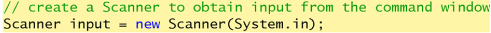

## 04)**Accepting Inputs With Different Data Types From The User:

### 04.1)**How To Get Any Input With Different Data Types From The User:

  - 
04.1.1)**At The Frist , You Must: <strong>import java.util.Scanner...</strong>

  
    - 
04.1.1.1)**java: It Refers To Java Library That Contains A Set Of Packages , And Classes...

    
    - 
04.1.1.2)**util: It Refers To The Utilities That Contains Different Java Classes...

    
    - 
04.1.1.3)**Scanner: It Is A Java Class That Used To Create An Object Scanner To Get Input From The User Of Your Own Java Computer Programming Codes...

    
    
    
  - 
04.1.2)**At The Second , You Must Create A Scanner , By Using: Scanner input = new Scanner(System.in);
   
  

-------------------------------------------------------------------------------

> [!Warning]
> 
Sccaner Class Must Start With A Capital Letter To Create The Scanner Class In Your Own Java Computer Programming Codes...

